<div align="center">
  
  <h1>เกงกิเดสซ์ · ระบบจัดก๊วนแบดมินตัน</h1>
  <p><b>元気です · Genki Desu Badminton Society</b></p>
  <p>ทุกวันเสาร์ 9:00 – 12:00 น. · The 18 Badminton Club (ใกล้ MRT ทิพวัล)</p>
  <p>จัดคิวตามเวลารอจริง · จับคู่มือใกล้เคียง · สลับคู่ไม่ให้ซ้ำ · <b>ไม่ดองใคร</b></p>
  <p>📖 <a href="#คู่มือการใช้งานแบบมีภาพประกอบ"><b>คู่มือการใช้งานฉบับเต็ม</b></a> — มีภาพประกอบทุกหน้าจอ สอนทีละขั้นตอน</p>
</div>

---

## สารบัญ

- [ปัญหาที่เว็บนี้แก้](#ปัญหาที่เว็บนี้แก้)
- [4 กลไกหลัก](#4-กลไกหลัก)
- [สูตรที่ใช้จัดคิว](#สูตรที่ใช้จัดคิว-เปิดเผยทั้งหมด)
- [ค่าก๊วนและการเก็บเงิน](#ค่าก๊วนและการเก็บเงิน)
- [ฟีเจอร์ที่ทำเสร็จแล้ว](#ฟีเจอร์ที่ทำเสร็จแล้ว)
- [โทนสี & งานออกแบบ](#โทนสี--งานออกแบบ)
- [เริ่มใช้งาน](#เริ่มใช้งาน)
- **[📖 คู่มือการใช้งานแบบมีภาพประกอบ](#คู่มือการใช้งานแบบมีภาพประกอบ)** ← ดูตรงนี้ถ้าอยากรู้วิธีกดใช้
- [ถ้าเจอปัญหา](#ถ้าเจอปัญหา)
- [โครงสร้างโค้ด](#โครงสร้างโค้ด)
- [ที่อยากทำต่อ](#ที่อยากทำต่อ-เรียงตามความคุ้มค่า)

---

## ปัญหาที่เว็บนี้แก้

หัวก๊วนต้องจำทุกอย่างในหัวพร้อมกัน: ใครมาแล้ว ใครนั่งรอมานานแค่ไหน มือใครเท่าไร
เพิ่งลงกับใครไปเมื่อกี้ ใครจ่ายเงินแล้ว ใช้ลูกไปกี่ลูก — พอคนเยอะ **จะมีคนถูกดอง**
(นั่งรอเป็นสิบ ๆ นาทีเพราะไม่มีใครนึกถึง) แล้วเขาก็ไม่กล้าทวง

ระบบนี้ย้ายภาระนั้นมาไว้ที่เว็บ: **เวลารอของทุกคนถูกจับเวลาจริง** และคนที่รอนานที่สุด
จะลอยขึ้นหัวคิวเองโดยไม่ต้องมีใครจำ

---

## 4 กลไกหลัก

### 1. คิวที่จับเวลาจริง
ทุกคนมี `queueSince` — นาฬิกาที่เริ่มเดินเมื่อ **เช็คอิน / จบเกม / เลิกพัก**
การ์ดในคิวเปลี่ยนสีตามเวลาที่รอ (ปรับเกณฑ์ได้ในหน้าตั้งค่า)

| สี | สถานะ | ค่าเริ่มต้น |
|---|---|---|
| ขาว | เพิ่งลงคิว | < 4 นาที |
| น้ำเงินอ่อน | รออยู่ | 4–8 นาที |
| ทอง | รอนาน | 8–15 นาที |
| แดงกระพริบ | **ถูกดอง** | ≥ 15 นาที |

### 2. ระดับมือ 7 ระดับ (ตามที่ก๊วนใช้เรียกกันจริง)

| ระดับ | ชื่อ | สี | ประมาณว่า |
|---|---|---|---|
| 1 | **หน้าบ้าน** | ฟ้าหม่น `#8fa3bf` | ตีสนุก ๆ ยังไม่เคยเล่นในก๊วนจริงจัง |
| 2 | **BG** | ฟ้าน้ำเงิน `#5a74a8` | เริ่มเล่นในก๊วน ตีโต้ได้ เริ่มจับตำแหน่งยืน |
| 3 | **N-** | น้ำเงิน `#3d5590` | เล่นคู่ได้ ลูกยังไม่นิ่งตลอดเกม |
| 4 | **N** | น้ำเงินคราม `#1d2447` | เล่นคู่ลื่น รู้จังหวะสลับหน้า-หลัง |
| 5 | **S** | ทอง `#bf9d65` | ตบ/ดรอป/หน้าเน็ตคม คุมเกมได้ |
| 6 | **P** | ทองเข้ม `#9c7c47` | ระดับก๊วนแข่ง ครบเครื่องทุกลูก |
| 7 | **OPEN** | แดงฮิโนมารุ `#c2223c` | ระดับแข่งรายการ / มือเปิด |

**ทั้ง 7 ขั้นมีสีของตัวเอง ไม่ใช้สีซ้ำกัน** ไล่เฉดจากฟ้าอ่อน (มือใหม่) → น้ำเงินเข้ม → ทอง → แดง (มือเปิด)
สีเดียวกันนี้ใช้ทั้งวงกลมชื่อ ป้ายระดับ และจุดนำหน้าชื่อบนจอใหญ่ กวาดตาทีเดียวก็รู้ว่าใครมือไหน

ข้อมูลผู้เล่นเก็บแค่ **ชื่อที่ใช้เรียกในก๊วน + ระดับมือ** — ไม่ต้องใส่ชื่อจริง ไม่แบ่งเพศ ไม่แบ่งประเภทสมาชิก

### 3. สุ่มลงเล่นให้มือใกล้เคียงกัน
กดปุ่มเดียว ระบบเลือก 4 คนที่ **มือห่างกันไม่เกิน 1 ขั้น** (ปรับได้) จากหัวคิว
แล้วแบ่ง 2 ฝั่งให้ผลรวมระดับมือสูสีที่สุด — พร้อม **บอกเหตุผลทุกครั้ง** ว่าทำไมจัดชุดนี้
(สำคัญมาก: คนในก๊วนยอมรับง่ายกว่าเยอะเมื่อเห็นว่าระบบคิดจากอะไร)

### 4. กฎเหล็ก: ไม่ดองคน
ใครรอเกินเพดานที่ตั้งไว้ **จะถูกบังคับใส่ลงเกมถัดไปก่อนคิดคะแนนอื่นทั้งหมด**
แม้ระดับมือจะห่างกว่าปกติ — เพราะ "ถูกดอง" ทำคนเลิกมาก๊วน แต่ "เจอคนมือห่าง 2 ขั้น 1 เกม" ไม่

---

## สูตรที่ใช้จัดคิว (เปิดเผยทั้งหมด)

**คะแนนความควรได้ลง** ของแต่ละคน:

```
priority = (นาทีที่รอ × waitWeight)          ← ค่าเริ่มต้น 1.0 / นาที
         + (จำนวนเกมที่ตามหลังคนอื่น × 4)     ← คนมาสาย/ลงน้อยได้ไล่คิวขึ้นมา
         + (ดันคิวด้วยมือ × 30)               ← หัวก๊วนกดดันคิวให้ได้
```

**คะแนนของกลุ่มที่เลือกมา 4 คน** (ยิ่งสูงยิ่งดี):

```
score = Σ priority ของทั้ง 4 คน
      − levelWeight  × (มือห่างกันกี่ขั้น) ^ 1.5    ← ห่าง 1 ขั้นแทบไม่โดนหัก, ห่าง 4 ขั้นเจ็บหนัก
      − varietyWeight × โทษการซ้ำคู่/ซ้ำคู่แข่งใน 6 เกมล่าสุด
      (+ ความสุ่มเล็กน้อย เฉพาะเมื่อกด "สุ่มใหม่")
```

ลำดับการตัดสินใจ:

1. **ล็อกคนที่ปักหมุด** (หัวก๊วนสั่งว่าคนนี้ต้องลง)
2. **ล็อกคนที่ถูกดอง** ทุกคนที่รอเกินเพดาน (สูงสุดเท่าจำนวนที่ลงได้)
3. ไล่ดูทุกชุดที่เป็นไปได้จากหัวคิว 14 คน (C(14,3) = 364 ชุด — เร็วกว่ากระพริบตา) แล้วเลือกชุดคะแนนดีสุด
4. ถ้าคนในคิวน้อยจนหาชุดที่มือใกล้กันไม่ได้ → **ผ่อนเพดานมือให้เองทีละขั้น** แล้วบอกในเหตุผลว่าผ่อนเพราะอะไร
5. แบ่ง 2 ฝั่งให้ผลรวมมือต่างกันน้อยสุด ตัดสินเสมอด้วยการไม่ซ้ำคู่เดิม
6. เก็บชุดรอง 3 ชุดไว้ให้ปุ่ม "สุ่มใหม่" สลับดูได้ทันทีโดยไม่ต้องคิดใหม่

ทุกน้ำหนักในสูตรปรับได้จากหน้าตั้งค่า (มีปุ่มคืนค่าเริ่มต้น) และมีเทสต์คุมพฤติกรรมไว้ 47 ข้อ

---

## ค่าก๊วนและการเก็บเงิน

ค่าเริ่มต้นฟิกตามโปสเตอร์ก๊วน: **ค่าสนามคนละ 70 บาท · ค่าลูกเก็บคนละ 25 บาทต่อลูก** (แก้ได้ทุกครั้งที่เปิดก๊วน)

> **25 คือ "เก็บคนละ 25 ต่อลูก" ไม่ใช่ราคาลูกที่เอามาหาร 4**
> เกมหนึ่งใช้ 1 ลูก → ทั้ง 4 คนในเกมนั้นจ่ายคนละ 25 บาท (ก๊วนเก็บได้ 100 บาท ซึ่งพอดีค่าลูกหนึ่งลูก)
> เกมที่ใช้ 2 ลูก → คนละ 50 บาท

**2 วิธีหารเงิน**

| โหมด | คิดยังไง | เหมาะกับ |
|---|---|---|
| **ระบบก๊วน** (ค่าเริ่มต้น) | ค่าสนามเก็บเท่ากันทุกคน (70) + **ค่าลูกเก็บคนละ 25 ต่อลูก เฉพาะเกมที่ตัวเองลง** | ก๊วนปกติ — คนมาสายหรือลงน้อยจ่ายน้อยลงตามจริง |
| **หารเท่ากันทุกคน** | กรอก 3 ยอด — ค่าสนามทั้งหมด + ค่าลูกทั้งหมด + ค่าอื่น ๆ แล้ว ÷ จำนวนคนที่มาวันนั้น | วันที่อยากจบง่าย ๆ ไม่นับเกม |

- **ลูกแบดผูกกับเกมเสมอ** — ไม่มีถังลูกลอย ๆ ที่ไม่รู้ว่าใครใช้ ลูกซ้อมก่อนเริ่มก๊วนออกให้ ไม่เก็บจากใคร
  · ค่าอื่น ๆ (น้ำ/ขนม) หารเท่ากันทุกคน
- ค่าลูกรายคนจึง**เป็นจำนวนเต็มเสมอ** ไม่มีเศษสตางค์ให้ต้องมานั่งอธิบาย
- หน้าค่าก๊วนมีรายการ **"ค่าลูกรายเกม"** บอกว่าแต่ละเกมใช้กี่ลูก คนละกี่บาท และ**แก้ย้อนหลังได้**
  ถ้าเกมไหนลืมใส่จำนวนลูกจะขึ้นเตือนให้ (ค่าลูกของเกมนั้นจะยังไม่ถูกคิดให้ใคร)
- ปัดเศษขึ้นทีละ 1/5/10 บาทได้
- อยากรู้ว่าวันนี้ก๊วนเหลือหรือขาด ให้กรอก **"ค่าสนามที่จ่ายจริงทั้งวัน"** และ **"ค่าลูกที่จ่ายจริงทั้งวัน"**
  — สองช่องนี้คือ*ต้นทุน* คนละเรื่องกับอัตราที่เก็บ ถ้าไม่กรอกระบบจะขึ้น "—" ไม่เดาให้ว่าต้นทุนเป็นศูนย์
- โหมดหารเท่าจะเหลือแค่ 3 ช่องให้กรอก ไม่มีช่องของระบบก๊วนมากวน
- **แตะชื่อใครในใบเสร็จ** → เด้ง **QR พร้อมเพย์ที่ผูกยอดของคนนั้นไว้แล้ว** สแกนปุ๊บแอปธนาคารขึ้นจำนวนเงินให้เลย
  ไม่ต้องกรอกเอง (ไม่มีโอนผิดยอด) แล้วกด "รับเงินแล้ว" ปิดยอดได้ในหน้าต่างเดียวกัน
- ในหน้าต่างเดียวกันยัง**ปรับจำนวนลูกที่คิดกับคนนั้นได้** (มาสาย/ลงครึ่งเกม — เก็บเป็นจำนวนลูก
  ยอดจึงขยับตามเองถ้าเปลี่ยนราคาลูกทีหลัง) และ**กดลดราคาเป็นบาทได้** มีปุ่มลัด 20/50/70/100
  หรือกรอกเองก็ได้ · ยอดกับ QR เปลี่ยนตามทันที · ส่วนลดขึ้นในใบเสร็จ ไฟล์ Excel และสรุปไลน์ด้วย
- ปุ่มเดียวก็อปสรุปทั้งก๊วนไปวางในไลน์ (ค่าใช้จ่าย + คนละเท่าไร + ใครจ่ายแล้ว + รางวัลประจำก๊วน)

### เก็บเงินเสร็จแล้วออกเป็นไฟล์ Excel

หน้าค่าก๊วน → ปุ่ม **"ไฟล์ Excel"** ได้ไฟล์ `.xlsx` 4 ชีต เปิดด้วย Excel / Google Sheets / Numbers ได้เลย

| ชีต | มีอะไร |
|---|---|
| **ค่าก๊วนรายคน** | ชื่อ · ระดับมือ · เช็คอิน-กลับ · เกมที่ลง · ชนะ-เสมอ-แพ้ · ค่าสนาม · ค่าลูก · ค่าอื่น ๆ · ยอดรวม · **จ่ายแล้ว/ยังไม่จ่าย** · จ่ายกี่โมง |
| **ยังไม่จ่าย** | เฉพาะคนที่ค้าง พร้อมยอดรวมที่ต้องตามเก็บ และโน้ตของคนนั้น (ถ้ามี) |
| **รายเกม** | ทุกเกม — ใคร vs ใคร · คะแนนครบทุกเซ็ต · ใครชนะ · ใช้กี่ลูก · **ค่าลูกเกมนั้นตกคนละเท่าไร** |
| **สรุปก๊วน** | วิธีคิดเงินที่ใช้วันนั้น · จำนวนคน/เกม/ลูก · ยอดเรียกเก็บ · เก็บได้แล้ว · ค้างอยู่ · เหลือเข้าก๊วนหรือก๊วนออกให้ก่อน |

หัวตารางถูกตรึงไว้และมีปุ่มกรองให้แล้ว แถวรวมใส่เป็นสูตร `SUM` จริง — แก้ตัวเลขในไฟล์เองยอดรวมก็ขยับตาม

ไฟล์เขียนขึ้นเองจาก zip + XML ใน [`api/xlsx.ts`](api/xlsx.ts) จึง**ไม่ต้องลงไลบรารีอะไรเพิ่ม**
(ตรวจแล้วด้วยการอ่านไฟล์กลับด้วยตัวอ่าน `.xlsx` คนละตัวสองตัว)

### QR ผูกยอดทำงานยังไง

QR พร้อมเพย์คือข้อความตามมาตรฐาน EMVCo ที่เข้ารหัสไว้ — ระบบสร้างใหม่ทุกครั้งจากเลขพร้อมเพย์ของก๊วน
บวกยอดของคนนั้น (`shared/promptpay.ts`) แล้ววาดเป็น SVG ในเครื่องผู้ใช้เลย **ไม่ต้องต่อเน็ต**

```
000201 010212 29370016A0000006770101110213<เลขพร้อมเพย์> 5303764 5406<ยอด> 5802TH 6304<CRC>
                 ↑ 12 = ใช้ครั้งเดียว (มียอด)                          ↑ เช่น 89.00
```

ใช้ระดับกันพลาด H จึงวางโลโก้ก๊วนทับกลาง QR ได้โดยยังสแกนติด · ถ้าเลขพร้อมเพย์ในไฟล์ตั้งค่าผิดรูปแบบ
ระบบจะถอยไปใช้รูป QR ใบเดิมของก๊วนให้อัตโนมัติ · ตรวจแล้วด้วยการถ่ายจากหน้าจอจริงแล้วอ่านกลับด้วยตัวอ่าน QR

ข้อมูลประจำก๊วน (สนาม ตาราง ค่าสนาม ค่าลูก เลขพร้อมเพย์) อยู่ในไฟล์เดียว: [`shared/club.ts`](shared/club.ts)

---

## ฟีเจอร์ที่ทำเสร็จแล้ว

### คุมก๊วนหน้างาน
- **หลายคอร์ตพร้อมกัน** — เพิ่ม/ลด/เปลี่ยนชื่อ/ปิดคอร์ตชั่วคราวได้กลางก๊วน
- **นาฬิกาในเกม** เปลี่ยนสีเมื่อเล่นเกินเวลาเป้า (คนอื่นรออยู่)
- **จบเกม** ใส่คะแนน **21 แต้ม 2 เซ็ต** (มีปุ่ม "A 21" / "B 21" กดไว)
  **ได้กันคนละเซ็ต = เสมอ** ซึ่งเป็นผลปกติของการตีไปกลับสองเซ็ต ไม่ใช่ผลที่ยังค้าง
  (จะตัดเซ็ตที่ 3 ก็กดเพิ่มได้) · หรือกด "ไม่จดคะแนน" แล้วเลือก ฝั่ง A / เสมอ / ฝั่ง B
  · ใส่จำนวนลูกที่ใช้ในเกมนั้นตรงนี้เลย → เก็บสถิติ **ชนะ-เสมอ-แพ้** รายคนให้อัตโนมัติ
- **จัดเกมล่วงหน้าเข้าคิว** — จัดคู่ไว้ตอนว่าง พอคอร์ตว่างกดปุ่มเดียวลงเลย
  ไม่ต้องมายืนจัดคนตอนที่กำลังวุ่นที่สุด · คอร์ตว่างใบแรกได้เกมที่ 1 ใบถัดไปได้เกมที่ 2
  · สลับลำดับคิวได้ · คนที่ถูกจัดไว้แล้วจะไม่ถูกเสนอซ้ำในเกมอื่น
  · **เลือกได้จากทุกคนในก๊วน รวมคนที่กำลังเล่นอยู่** — กว่าจะถึงคิวนั้นเขาก็ลงจากคอร์ตแล้ว
    จะได้จัดล่วงหน้าได้หลายเกมติดกัน ไม่ใช่จัดได้แค่เท่าจำนวนคนที่นั่งรออยู่
  · ตอนเลือกคนเห็น **เวลารอของแต่ละคน** และเรียงคนที่รอนานสุดไว้บนสุด
  · กดลงคอร์ตจากคิวแล้ว **เรียกชื่อออกเสียง** เหมือนตอนสุ่มจัดเกม
  · เกมที่รอคนลงจากคอร์ตจะบอกว่า "รอ X จบเกมก่อน" (เรื่องปกติ) แยกจาก "มีคนกลับบ้านแล้ว" (ปัญหาจริง สีแดง)
- **จัดเอง** — เลือก 4 คนเอง ระบบแบ่งฝั่งให้สูสี
- **สลับตัวกลางเกม** (เจ็บ/ขอเปลี่ยน) คนที่ออกกลับไปต่อคิวทันที
- **ยกเลิกเกม** — คืนเวลารอเดิมให้ทุกคน ไม่มีใครเสียคิวฟรี
- **ย้อนกลับ (undo)** 25 ขั้น สำหรับตอนกดผิดหน้างาน
- **เรียกชื่อด้วยเสียง** — กระดิ่ง + อ่านชื่อเป็นภาษาไทย ("คอร์ต 2 เชิญ ... ลงสนามครับ")

### คน
- ทะเบียนผู้เล่นถาวร: ชื่อที่ใช้เรียก + ระดับมือ (แก้/ลบได้)
- เช็คอินหลายคนพร้อมกัน, เพิ่มคนใหม่แล้วเช็คอินในคลิกเดียว
- สถานะ: รอคิว / อยู่ในคอร์ต / ขอพัก / กลับบ้านแล้ว (กลับมาใหม่ได้)
- ดันคิวด้วยมือ (+) สำหรับกรณีพิเศษ
- ประเภทเกม: คู่ (หลัก) และเดี่ยว (เผื่อคนเหลือ 2-3 คน)

### ให้ลูกก๊วนดูเอง
- **ลิงก์ดูคิว `/q/<รหัส 4 ตัว>`** — ไม่ต้องล็อกอิน ดูอย่างเดียว
  เลือกชื่อตัวเองครั้งเดียว แล้วหน้าจะบอก **"คิวที่เท่าไร / อีกกี่เกม / ประมาณกี่นาที"**
  และถ้าถูกจัดไว้ในคู่แล้ว จะขึ้นว่า **"คุณถูกจัดไว้แล้ว — คู่ที่ N ที่รอลง"** พร้อมชื่อคู่แข่ง
  (สำคัญกว่าเลขคิวดิบ เพราะรู้แน่แล้วว่าได้ลงเกมไหน) · มีรายการคู่ที่รอลงทั้งหมดให้ดูด้วย
- **โหมดจอใหญ่ `/tv`** — เอาทีวีหรือจอมอนิเตอร์ตั้งข้างคอร์ต ลูกก๊วนดูเองได้ไม่ต้องถามหัวก๊วน
  แบ่งสองคอลัมน์: **ซ้าย = คอร์ตที่กำลังเล่น** (ชื่อตัวใหญ่ นาฬิกาจับเวลา เปลี่ยนเป็นสีแดงเมื่อเกินเวลาเป้า)
  · **ขวา = คู่ต่อไปที่รอลง** อย่างเดียว ไม่มีคิวรายคนมาแย่งพื้นที่
  ทดสอบแล้วไม่ล้นจอทั้ง 1366×768 / 1920×1080 / 2560×1440
- ทั้งสองหน้าอัปเดตเองทุก 3–5 วินาที

### สถิติ
- รายคนในก๊วนวันนี้: เกมที่ลง, **ชนะ-เสมอ-แพ้**, เวลาเล่นรวม, **เวลารอรวม**, รอนานสุด
- ตัวชี้วัดความยุติธรรม: "คนลงเยอะสุดกับน้อยสุดห่างกันกี่เกม"
- รางวัลประจำก๊วน: ลงเยอะสุด / ใจเย็นสุด (รอนานสุด) / ชนะเยอะสุด
- สถิติรวมทุกก๊วน + ประวัติก๊วนย้อนหลัง + ส่งออก CSV ทุกเกม

### ของระบบ
- **PWA** ติดตั้งเป็นแอปบนมือถือได้, โหลดเร็ว, ใช้ได้เมื่อเน็ตกระตุก (หน้าเว็บแคช, ข้อมูลไม่แคช)
- **โหมดกลางคืน** สำหรับโรงยิมแสงน้อย
- **PIN หัวก๊วน** (ไม่บังคับ) — ทุกคนดูได้ แต่เฉพาะเครื่องที่มี PIN สั่งการได้
- **ลบก๊วนที่ไม่อยากเก็บได้** — หน้าสถิติ → "ก๊วนที่ผ่านมา" → ถังขยะ (ก๊วนที่ยังเล่นอยู่ลบไม่ได้ ต้องปิดก่อน)
  ไฟล์ถูกย้ายไปเป็น `.deleted-<เวลา>` ในโฟลเดอร์ `data/sessions/` ไม่ได้ลบทิ้งจริง เผื่อกดผิด
- **ดู/แก้ทะเบียนสมาชิกได้ตลอด ไม่ต้องเปิดก๊วนก่อน** — เมนู (⋯) → “ทะเบียนสมาชิก”
  หรือปุ่มในหน้าเปิดก๊วน แก้ชื่อ เปลี่ยนระดับมือ ใส่รูป เพิ่ม/ลบคน และดูสถิติรวมทุกครั้งที่เคยมา
- **ลบคนออกจากทะเบียนได้** — เผื่อเพิ่มชื่อซ้ำหรือเพิ่มผิดคน
  · ชื่อที่เพิ่งเพิ่มแล้วยังไม่ได้ลงเล่น ลบจบในคลิกเดียว (ถ้าเผลอเช็คอินไปแล้ว
  ระบบเช็คเอาท์ให้ก่อนแล้วลบต่อให้ พร้อมถอนชื่อออกจากบิลวันนี้ ไม่เหลือหัวผีไว้)
  · คนที่เคยลงก๊วนมาแล้วต้องยืนยันอีกชั้น โดยบอกว่าลงไปกี่ครั้งกี่เกม
  · ลบแล้ว **บิลกับสถิติของก๊วนเก่าไม่ถูกแตะต้อง** ยอดเงินเดิมไม่ขยับและยังขึ้นชื่อให้อ่านออก
  (ชื่อถูกเก็บไว้ใน `data/removed-players.json`) · คนที่อยู่ในคอร์ตตอนนั้น ลบไม่ได้จนกว่าจะจบเกม
- **สำรอง / ย้ายข้อมูลไปเครื่องอื่นได้ด้วยไฟล์เดียว** — หน้าตั้งค่า → “สำรองข้อมูล”
  ได้ไฟล์ `genki-backup-<วันเวลา>.json` ที่มีทะเบียน ประวัติก๊วนทุกครั้ง บิล และรูปครบ
  · พกคอมไปอีกเครื่อง: โคลนโปรเจกต์ → `npm ci` → กด “กู้ข้อมูลจากไฟล์สำรอง” → เลือกไฟล์ จบ
  · ก่อนกู้จะโชว์ให้ดูก่อนว่าในไฟล์มีสมาชิกกี่คน ก๊วนกี่ครั้ง สำรองไว้เมื่อไร
  · กู้ทับของเดิมได้ **ระบบยกโฟลเดอร์ `data/` เดิมไปเก็บเป็น `data.before-restore-<เวลา>` ให้ก่อนเสมอ**
  (กดผิดไฟล์ก็เอากลับมาได้) · ปุ่มนี้ใช้ได้แม้ยังไม่ได้เปิดก๊วน
- **หรือจะเก็บข้อมูลไว้ใน git ไปเลยก็ได้** — `git clone` แล้ว `npm start` ได้ข้อมูลครบทันที
  ไม่ต้องก็อปไฟล์อะไรเพิ่ม · ดูหัวข้อ [เก็บข้อมูลไว้ใน git](#เก็บข้อมูลไว้ใน-git-ย้ายเครื่องด้วย-git-clone) ด้านล่าง
  (**ทำได้เฉพาะตอน repo เป็น private** เพราะข้างใน `data/` มีรูปหน้าและชื่อลูกก๊วน)
- **ทะเบียนลูกก๊วนอยู่ถาวร ไม่หายไปกับก๊วนที่ลบ** — เก็บแยกใน `data/roster.json` คนละไฟล์กับประวัติก๊วน
  เพิ่มสมาชิกครั้งเดียวใช้ได้ตลอด ไม่ต้องกรอกใหม่ทุกอาทิตย์
  ถ้าอยากล้างประวัติก๊วนทั้งหมดแต่เก็บคนไว้: `npm run reset-sessions`
  (ย้ายไปเป็นโฟลเดอร์สำรอง ไม่ได้ลบจริง · **อย่าลบโฟลเดอร์ `data/` ทั้งก้อน** เพราะทะเบียนคนจะหายไปด้วย)
- นาฬิกาซิงก์กับเซิร์ฟเวอร์ เวลารอตรงกันทุกเครื่อง แม้เวลาในมือถือเพี้ยน
- **กันจอขาว** — ถ้าหน้าไหนพังกลางการวาด จะขึ้นกล่องบอกว่าพังตรงไหน พร้อมปุ่มโหลดใหม่ / ล้างแคช
  แทนที่จะเหลือจอว่างเปล่าที่หาสาเหตุไม่ได้
- **อ่านข้อมูลรุ่นเก่าได้** — ก๊วนที่เปิดไว้ก่อนเปลี่ยนระบบ (ระดับมือ 10 ขั้น, มีเพศ/สมาชิก, ค่าก๊วนแบบเก่า)
  ถูกแปลงให้อัตโนมัติตอนเปิดครั้งแรก
- **ไฟดับแล้วข้อมูลไม่หาย** — ทุกครั้งที่บันทึก เขียนลงไฟล์ชั่วคราวแล้ว `fsync` ให้ลงจานจริงก่อน
  ค่อยสลับทับของเดิม (atomic) และเก็บไฟล์สำรองคู่ไว้เสมอ
  ถ้าไฟล์หลักพัง ระบบจะกู้จากไฟล์สำรองให้เอง และเก็บไฟล์ที่พังไว้เป็น `.broken-<เวลา>` ไม่ลบทิ้ง
  (ถ้าปล่อยให้เริ่มจากค่าว่างเฉย ๆ การบันทึกครั้งถัดไปจะทับทะเบียนลูกก๊วนทั้งก๊วนหายโดยไม่มีใครรู้)

---

## โทนสี & งานออกแบบ

สีทั้งหมด **ถอดมาจากไฟล์โลโก้จริง** (สุ่มพิกเซลแล้วหาค่าเฉลี่ยของแต่ละโทน):

| สี | ค่า | ใช้ที่ไหน |
|---|---|---|
| น้ำเงินคราม | `#1d2447` | สีหลัก ปุ่ม พื้นสนามในคอร์ต |
| แดงฮิโนมารุ | `#c2223c` | เตือน "ถูกดอง", ฝั่ง B, จุดเน้น |
| ทอง | `#bf9d65` | เส้นคั่น ป้ายมือ P, รางวัล |
| ครีมทราย | `#ede1d1` | ตัวอักษรบนพื้นเข้ม, วงแปรง |
| กระดาษวาชิ | `#fbf7ef` | พื้นหลังทั้งเว็บ |

องค์ประกอบญี่ปุ่นที่ยกมาจากโลโก้: **ลายคลื่นเซกาอิฮะ (青海波)** เป็นพื้นหลังบาง ๆ,
**วงแปรง** ล้อมโลโก้, **จุดฮิโนมารุ** นำหัวข้อคอร์ต, เส้นทองบางคั่นแต่ละส่วน,
และคันจิ 元気です กำกับชื่อก๊วน — ฟอนต์ Kanit (หัวข้อ) + IBM Plex Sans Thai (เนื้อหา) + Shippori Mincho (คันจิ)

สีวงกลมหน้าชื่อผู้เล่นไล่ตามระดับมือ (หน้าบ้าน/BG → น้ำเงินอ่อน · N-/N → น้ำเงินเข้ม · S/P → ทอง · OPEN → แดง)
กวาดตาดูคิวทีเดียวก็รู้ว่าใครมือประมาณไหน

---

## เริ่มใช้งาน

> **ต้องมี Node 20.19 ขึ้นไป** (แนะนำ v22 LTS) — เช็คด้วย `node -v`
>
> Ubuntu/Debian แถม Node 12 มาให้ ซึ่งเก่าเกินไป ลงตัวใหม่ทับได้เลย:
>
> ```bash
> curl -fsSL https://deb.nodesource.com/setup_22.x | sudo -E bash -
> sudo apt-get install -y nodejs
> ```
>
> macOS: `brew install node@22` · Windows: โหลด LTS จาก [nodejs.org](https://nodejs.org)
>
> **ถ้า apt ลงไม่ได้** (มีแพ็กเกจอื่นค้างอยู่ หรือไม่มีสิทธิ์ sudo) ลงลงในโฟลเดอร์ตัวเองแทนได้
> ไม่ต้องยุ่งกับแพ็กเกจของระบบเลย — ดูเลขเวอร์ชันล่าสุดที่ [nodejs.org/dist/latest-v22.x](https://nodejs.org/dist/latest-v22.x/)
> แล้วแทนใน `<ver>`:
>
> ```bash
> cd /tmp && curl -fLO https://nodejs.org/dist/v<ver>/node-v<ver>-linux-x64.tar.xz
> mkdir -p ~/.local && tar -xJf node-v<ver>-linux-x64.tar.xz -C ~/.local
> echo 'export PATH="$HOME/.local/node-v<ver>-linux-x64/bin:$PATH"' >> ~/.bashrc
> export PATH="$HOME/.local/node-v<ver>-linux-x64/bin:$PATH"
> ```
>
> ถ้า Node เก่าเกินไป `npm run build` จะบอกให้เองตั้งแต่ก่อนเริ่ม
> (ไม่ใช่ปล่อยให้ไปตกเป็น `SyntaxError: Unexpected token '.'` ซึ่งอ่านไม่ออกว่าคืออะไร)

```bash
npm install
npm run dev          # เปิด http://localhost:3100 (มือถือในวง Wi-Fi เดียวกันเปิดได้ด้วย)
```

ขึ้นเครื่องจริง:

```bash
npm run serve        # = npm run build && npm start
```

**Windows (PowerShell / cmd)** ใช้คำสั่งเดียวกันได้เลย ไม่ต้องตั้ง `NODE_ENV` นำหน้า
อยากเปลี่ยนพอร์ตค่อยตั้งแยกบรรทัด:

```powershell
$env:PORT = "8080"; npm run serve
```

ตัวแปรที่ตั้งได้ (ดู `.env.example`):

| ตัวแปร | ค่าเริ่มต้น | ความหมาย |
|---|---|---|
| `PORT` | 3100 | พอร์ตที่เซิร์ฟเวอร์ฟัง |
| `DATA_DIR` | `./data` | โฟลเดอร์เก็บข้อมูล (ย้ายเครื่องแค่ก็อปโฟลเดอร์นี้) |
| `ORGANIZER_PIN` | ว่าง | PIN หัวก๊วน — ว่างไว้ = ใครเปิดลิงก์ได้ก็สั่งการได้ |

> **ไม่รู้จะเริ่มกดตรงไหน?** อ่าน [คู่มือการใช้งานแบบมีภาพประกอบ](#คู่มือการใช้งานแบบมีภาพประกอบ)
> ด้านล่าง — สอนทีละหน้าจอ พร้อมภาพจริงทุกขั้นตอน ตั้งแต่เปิดก๊วนจนถึงเก็บเงิน

### ลองกดเล่นก่อนด้วยก๊วนตัวอย่าง

อยากเห็นหน้าตาและไฟล์ Excel ก่อนใช้งานจริง — ใส่ก๊วนสมมติให้กดเล่นได้เลย

```bash
npm run serve     # หน้าต่างที่ 1
npm run demo      # หน้าต่างที่ 2
```

ได้ลูกก๊วน 14 คน เล่นไป 10 เกม จ่ายแล้ว 9 คน ค้าง 5 คน (มีเกมที่จงใจลืมกดลูกไว้ให้ดูด้วย)
แล้วเปิด `http://localhost:3100/bill` กดปุ่ม **"ไฟล์ Excel"** ได้เลย

ล้างข้อมูลตัวอย่างทิ้ง: ปิดเว็บก่อน แล้วลบโฟลเดอร์ `data`
(macOS/Linux: `rm -rf data` · Windows PowerShell: `Remove-Item -Recurse -Force data`)
ถ้ามีข้อมูลอยู่แล้ว `npm run demo` จะไม่ยัดทับให้ — กันข้อมูลจริงหาย

### เปิดให้ลูกก๊วนใช้จากมือถือ

ตอนเซิร์ฟเวอร์เริ่มทำงาน มันจะพิมพ์ไอพีสำหรับมือถือให้เองเลย:

```
🏸 Genki Desu Badminton — เปิดใช้งานแล้ว
   เครื่องนี้          http://localhost:3100/
   มือถือใน Wi-Fi นี้   http://192.168.1.20:3100/     ← พิมพ์อันนี้ในมือถือ
   ข้อมูลเก็บที่        /home/pi/genki-badminton/data
```

เลือกวิธีรันตามสถานการณ์:

#### 1. ที่โรงยิม — ง่ายสุด ไม่ต้องมีอินเทอร์เน็ต

รันบนโน้ตบุ๊ก (หรือมือถือที่แชร์ฮอตสปอต) ที่อยู่ Wi-Fi เดียวกับลูกก๊วน แล้วบอกไอพีข้างบน

```bash
npm run serve        # build แล้วรัน
```

#### 2. รันตลอดเวลาด้วย Docker — แนะนำสุดถ้ามีเครื่องเปิดทิ้งไว้

ใช้ได้กับมินิพีซี / Raspberry Pi / VPS / NAS อะไรก็ได้ที่ลง Docker ได้

```bash
docker compose up -d --build     # รันเลย และขึ้นเองทุกครั้งที่เปิดเครื่อง
docker compose logs -f           # ดู log
docker compose ps                # เช็กว่ายังรันอยู่
```

ตั้ง `restart: unless-stopped` ไว้แล้ว — ไฟดับ/รีบูตก็กลับมาเอง
ข้อมูลอยู่ในโฟลเดอร์ `data/` ข้างไฟล์ `docker-compose.yml` (**สำรองแค่ก็อปโฟลเดอร์นี้**)

อัปเดตเวอร์ชันใหม่: `git pull && docker compose up -d --build`

#### 3. รันตลอดเวลาแบบไม่ใช้ Docker

```bash
bash deploy/install.sh           # ลง Node + build + ตั้ง pm2 ให้ขึ้นเองตอนรีบูต
```

จบแล้วคุมด้วย `pm2 logs genki` / `pm2 restart genki`
อัปเดต: `git pull && npm ci && npm run build && pm2 restart genki`

#### 4. เข้าจากนอกบ้าน — ได้ลิงก์ `https://` ส่งเข้าไลน์กลุ่ม

ไม่ต้องตั้งพอร์ตที่เราเตอร์ ไม่ต้องมีไอพีจริง เลือกตามวิธีที่ใช้รันอยู่:

```bash
# ถ้ารันด้วย Docker
docker compose --profile public up -d --build
bash deploy/link.sh           # พิมพ์ลิงก์ออกมาให้

# ถ้ารันด้วย pm2 / npm run serve
bash deploy/tunnel.sh         # โหลด cloudflared ให้เอง แล้วพิมพ์ลิงก์ออกมา
```

> **ตั้ง PIN ก่อนเปิดเป็นลิงก์สาธารณะ** — ไม่งั้นใครได้ลิงก์ไปก็กดจบเกม ลบคน ปิดก๊วนได้หมด
> เอา `#` หน้า `ORGANIZER_PIN` ใน `docker-compose.yml` ออก (หรือ `ORGANIZER_PIN=1234 bash deploy/install.sh`)
> คนที่ไม่มี PIN ยังเปิดดูคิวได้ตามปกติ แค่สั่งการไม่ได้

**ลิงก์ถาวร** (ลิงก์ชั่วคราวข้างบนจะเปลี่ยนทุกครั้งที่รันใหม่) — ต้องมีบัญชี Cloudflare ฟรี

1. [Zero Trust](https://one.dash.cloudflare.com/) → Networks → Tunnels → Create a tunnel → Cloudflared
2. ตั้งชื่อ แล้วก็อป **token** ที่ได้มา
3. ชี้ Public hostname ไปที่ `http://localhost:3100` (หรือ `http://genki:3100` ถ้าใช้ Docker)
4. รันด้วย token นั้น — ได้ลิงก์เดิมทุกครั้ง แม้รีบูตเครื่อง

```bash
# Docker — สลับไปใช้บรรทัด command ที่มี token ใน docker-compose.yml
CLOUDFLARE_TUNNEL_TOKEN=xxxxx docker compose --profile public up -d

# pm2 / npm
CLOUDFLARE_TUNNEL_TOKEN=xxxxx bash deploy/tunnel.sh
```

ถ้ามีโดเมนของตัวเองอยู่แล้ว จะตั้งเป็น `genki.yourdomain.com` ก็ได้

> เปิดผ่าน `https://` แล้วติดตั้งเป็นแอปลงหน้าจอมือถือได้ (PWA) — ถ้าเปิดผ่าน `http://` ไอพีในวง Wi-Fi
> เบราว์เซอร์จะจำกัดบางฟีเจอร์ (ปุ่มก็อปมีทางสำรองให้แล้ว แต่ติดตั้งเป็นแอปไม่ได้)

---

## คู่มือการใช้งานแบบมีภาพประกอบ

ภาพประกอบทั้งหมดในคู่มือนี้ถ่ายจากเว็บจริง (ขนาดจอมือถือ) โดยใช้ข้อมูลตัวอย่างที่สร้างขึ้นเพื่อสาธิต
ไม่ใช่ข้อมูลสมาชิกจริงของก๊วน — ใช้ดูเพื่อให้เห็นหน้าตาและขั้นตอนจริงเท่านั้น

สารบัญ:

- [1. เริ่มก๊วนใหม่](#1-เริ่มก๊วนใหม่)
- [2. เมนูหลัก](#2-เมนูหลัก)
- [3. ทะเบียนสมาชิก](#3-ทะเบียนสมาชิก)
- [4. หน้าคอร์ต — คุมก๊วนสด](#4-หน้าคอร์ต--คุมก๊วนสด)
- [5. จัดคนลงคอร์ต](#5-จัดคนลงคอร์ต)
- [6. หน้าคิวรอ](#6-หน้าคิวรอ)
- [7. เช็คอิน](#7-เช็คอิน)
- [8. คิดเงิน / เก็บเงิน](#8-คิดเงิน--เก็บเงิน)
- [9. สถิติ](#9-สถิติ)
- [10. ตั้งค่า และสำรอง/กู้ข้อมูล](#10-ตั้งค่า-และสำรองกู้ข้อมูล)
- [11. แชร์ให้ลูกก๊วนดูคิวเอง](#11-แชร์ให้ลูกก๊วนดูคิวเอง)
- [12. จอใหญ่ (TV)](#12-จอใหญ่-tv)
- [13. ลบคนออกจากทะเบียน](#13-ลบคนออกจากทะเบียน)

---

### 1. เริ่มก๊วนใหม่

เปิดเว็บขึ้นมาครั้งแรก (หรือหลังก๊วนก่อนหน้าถูกปิดแล้ว) จะเจอหน้าตั้งค่าก๊วน กรอกชื่อก๊วน
สถานที่ และจำนวนคอร์ต แล้วกด **"เปิดก๊วน"**

<p align="center">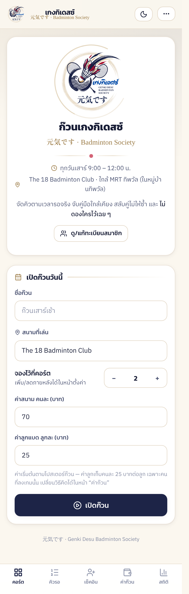</p>

กรอกชื่อก๊วนและสถานที่ไว้ด้านบน กดปุ่ม **"+"** ข้างจำนวนคอร์ตเพื่อเพิ่ม/ลดจำนวนคอร์ตที่จะใช้วันนี้
(ปรับได้อีกทีหลังเปิดก๊วนแล้วเช่นกัน ถ้าคอร์ตจริงไม่พอหรือเหลือ)

<p align="center">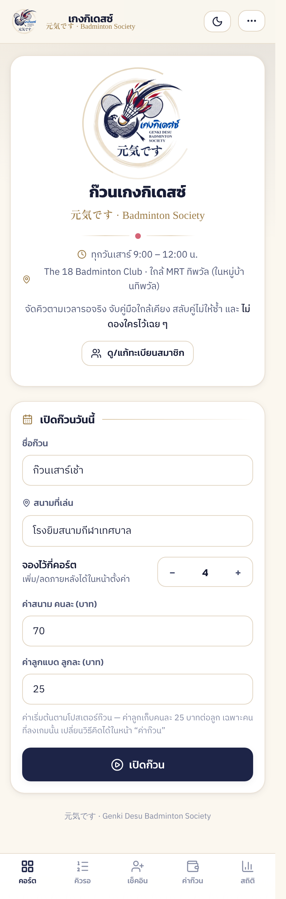</p>

> ถ้ายังไม่เคยเปิดก๊วน แต่อยากดู/แก้ **ทะเบียนสมาชิก** ก่อน ไม่ต้องรอเปิดก๊วน — มีปุ่มเข้าทะเบียนอยู่ในหน้านี้เลย
> (ดูหัวข้อ [ทะเบียนสมาชิก](#3-ทะเบียนสมาชิก))

---

### 2. เมนูหลัก

ปุ่ม **"เมนู"** (สามจุด มุมบนขวา) มีทุกหน้าของเว็บ กดแล้วเห็นทางลัดไปหน้าอื่น ๆ ทั้งหมด
เช่น ทะเบียนสมาชิก, แชร์ลิงก์ดูคิว, หน้าตั้งค่า, สถิติ

<p align="center">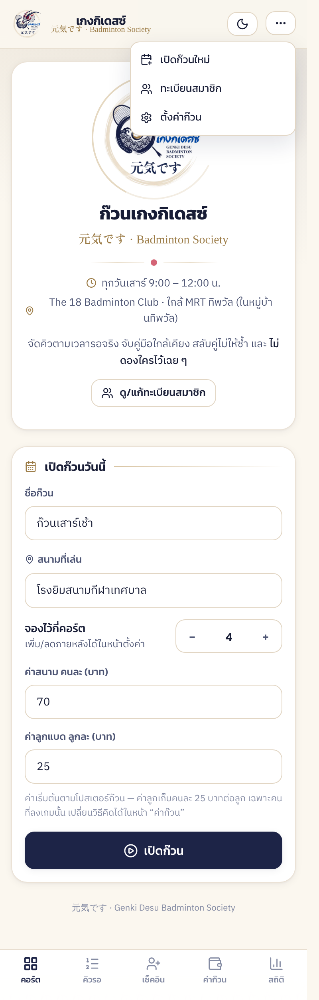</p>

---

### 3. ทะเบียนสมาชิก

ทะเบียนสมาชิกเป็นหน้าที่ **เข้าได้ตลอดเวลา ไม่ต้องเปิดก๊วนก่อน** — ดู/แก้ชื่อ ระดับมือ
และรูปของลูกก๊วนแต่ละคนได้ทุกเมื่อ เข้าได้จากเมนู (⋯) → "ทะเบียนสมาชิก" หรือปุ่มในหน้าเปิดก๊วน

#### ดูรายชื่อทั้งหมด

ด้านบนมีชิปสรุปจำนวนคนแยกตามระดับมือ กดชิปเพื่อกรองดูเฉพาะระดับนั้น
แต่ละแถวบอกระดับมือปัจจุบัน จำนวนครั้งที่มาก๊วน จำนวนเกมที่เคยลง และสถิติแพ้ชนะสะสม

<p align="center">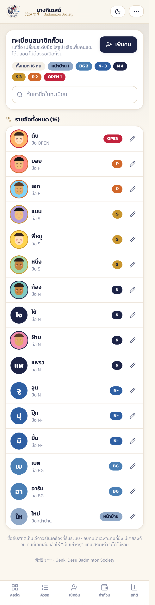</p>

#### เพิ่มสมาชิกใหม่

กด **"เพิ่มคน"** มุมบนขวาของรายชื่อ กรอกชื่อที่จะใช้เรียก เลือกระดับมือ (ไม่บังคับใส่รูปตอนนี้ก็ได้)

<p align="center">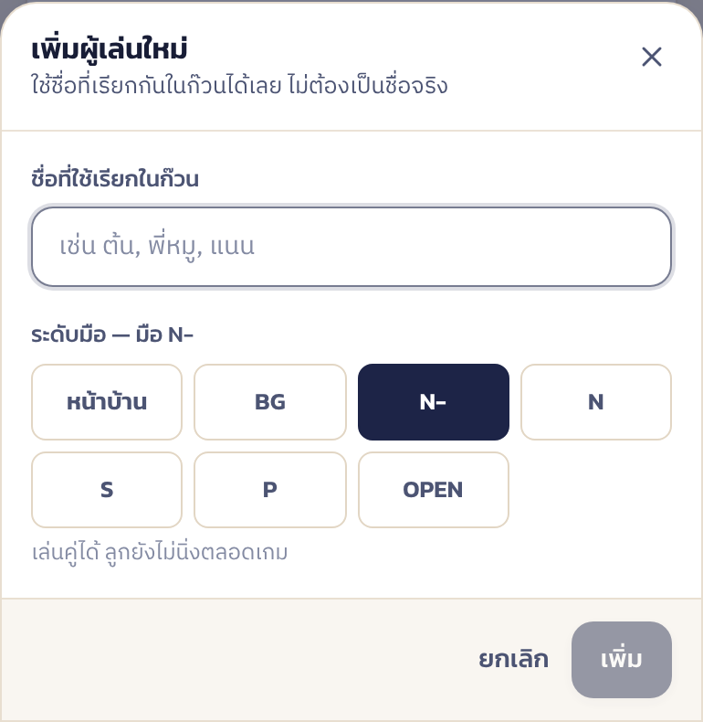</p>
<p align="center">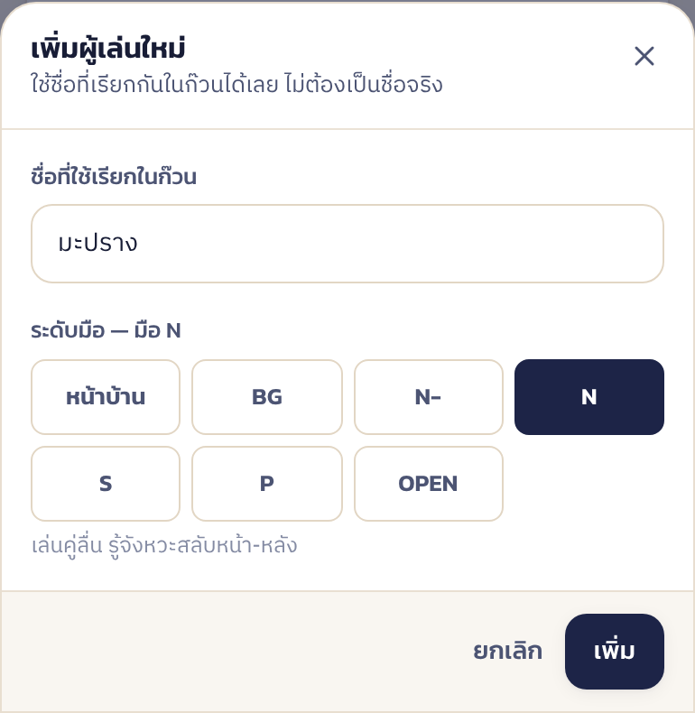</p>

กดยืนยันแล้วจะเห็นข้อความแจ้งด้านบนและชื่อใหม่ปรากฏในรายชื่อทันที

<p align="center">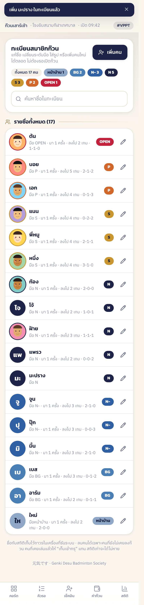</p>

#### แก้ไขข้อมูล / ใส่รูป

กดดินสอ (แก้ข้อมูล) ข้างชื่อใครก็ได้ เพื่อเปลี่ยนชื่อ ระดับมือ หรือใส่/เปลี่ยนรูปประจำตัว

<p align="center">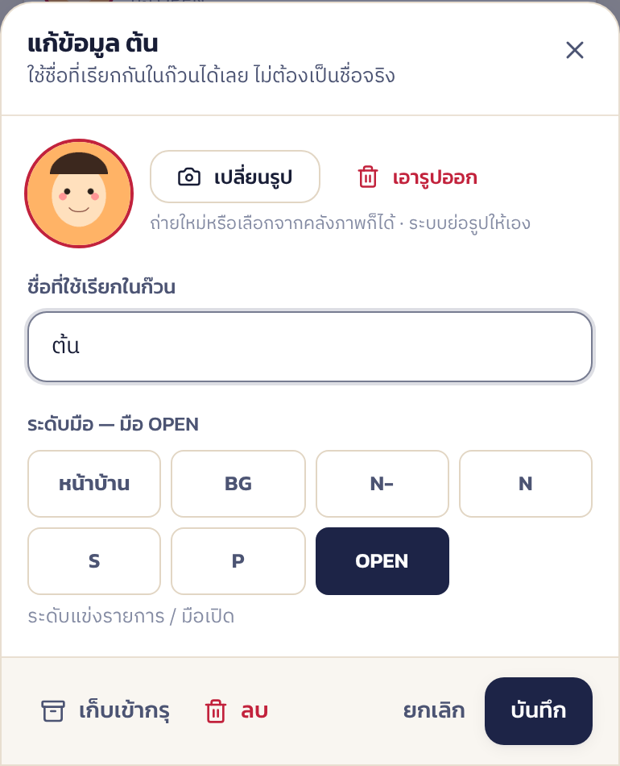</p>

เวลาอัปโหลดรูป ระบบจะเปิดหน้าต่างให้ **ตัดกรอบรูปเอง** ก่อนบันทึก เลื่อน/ซูมได้จนกว่าจะพอใจ

<p align="center">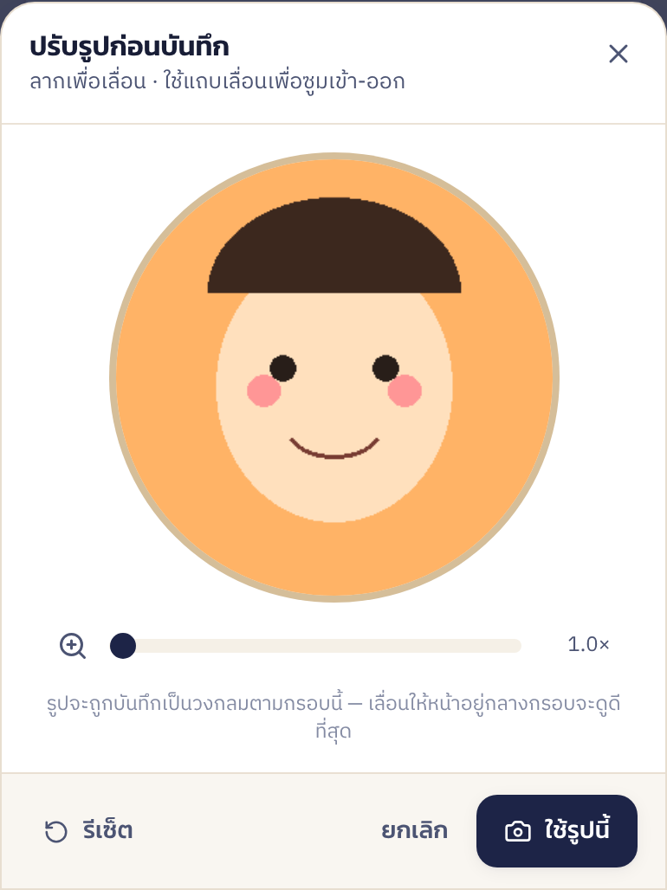</p>

#### ค้นหาชื่อในทะเบียน

พิมพ์ในช่องค้นหาด้านบนรายชื่อ กรองตามชื่อได้ทันทีเวลาทะเบียนมีคนเยอะ

<p align="center">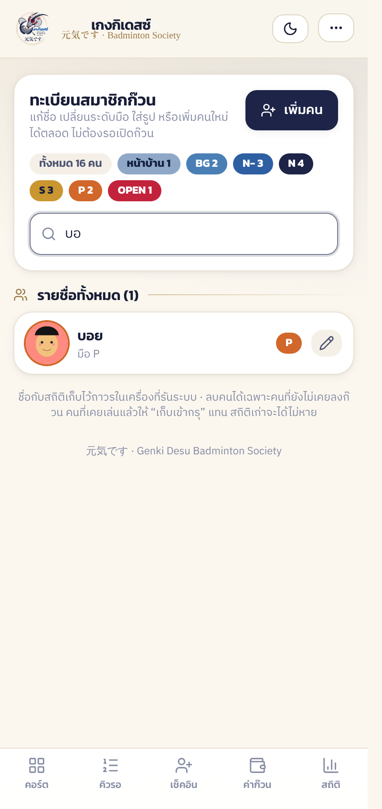</p>

การลบสมาชิกออกจากทะเบียนอธิบายแยกไว้ในหัวข้อ [13. ลบคนออกจากทะเบียน](#13-ลบคนออกจากทะเบียน)
เพราะมีรายละเอียดเรื่องประวัติการลงก๊วนที่ควรอ่านก่อนกด

---

### 4. หน้าคอร์ต — คุมก๊วนสด

หน้านี้เป็นหน้าหลักระหว่างก๊วน เห็นทุกคอร์ตพร้อมกัน คอร์ตที่มีคนเล่นอยู่จะโชว์ชื่อ 4 คน
(หรือ 2 คนถ้าเดี่ยว) พร้อม**นาฬิกาจับเวลาจริง** ที่จะเปลี่ยนเป็นสีแดงถ้าเล่นเกินเวลาเป้าขณะมีคนรออยู่
ด้านล่างมีคิวเกมที่จัดไว้ล่วงหน้า รอให้คอร์ตว่างแล้วลงอัตโนมัติ

<p align="center">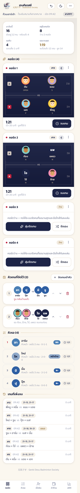</p>

จบเกมให้กดที่คอร์ตนั้นเพื่อใส่คะแนน (21 แต้ม 2 เซ็ต มีปุ่ม "A 21" / "B 21" กดไว หรือจะกด
"ไม่จดคะแนน" แล้วเลือกแค่ฝั่งที่ชนะก็ได้) และใส่จำนวนลูกที่ใช้ในเกมนั้น ระบบจะคิดค่าลูก
และสถิติแพ้-ชนะ-เสมอให้อัตโนมัติ

---

### 5. จัดคนลงคอร์ต

พอมีคอร์ตว่างหรืออยากจัดคิวล่วงหน้า กดปุ่ม **"จัดเกมเข้าคิว"** จะมีสองโหมดให้เลือก

#### ให้ระบบจัดอัตโนมัติ

ระบบเสนอคู่ที่มือใกล้เคียงกันและรอนานที่สุดมาให้เลย กดยืนยันได้เลยถ้าเห็นด้วย
หรือกด "สุ่มใหม่" เพื่อขอคู่อื่น

<p align="center">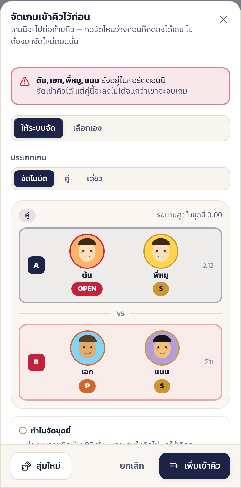</p>

#### เลือกคนเอง

สลับไปโหมด **"เลือกเอง"** จะเห็นการ์ดรูปใหญ่ของทุกคนที่พร้อมลง (รวมถึงคนที่กำลังเล่นอยู่คอร์ตอื่น
เผื่อจะจัดคิวล่วงหน้าให้เขาด้วย) เลือก 4 คนตามต้องการ ระบบช่วยแบ่งฝั่ง A/B ให้สูสี

<p align="center">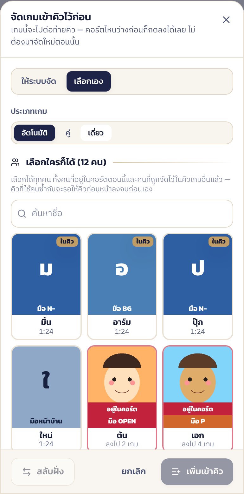</p>
<p align="center">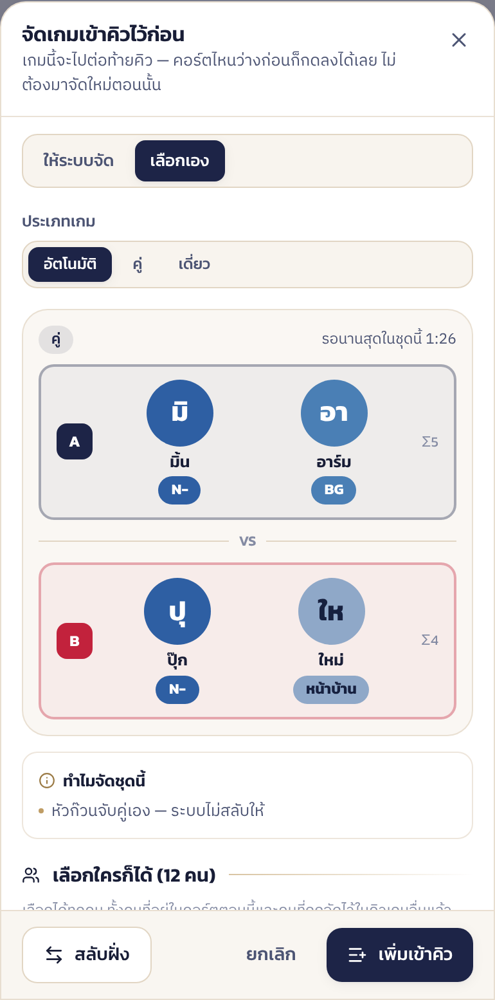</p>

มีช่อง **ค้นหาชื่อ** ด้านบนการ์ด เวลาก๊วนคนเยอะจะได้ไม่ต้องไล่หาทีละคน

<p align="center">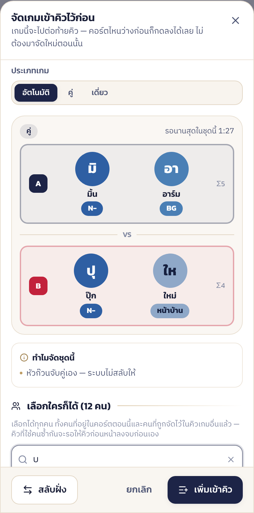</p>

---

### 6. หน้าคิวรอ

รายชื่อทุกคนที่กำลังรอคิวอยู่ เรียงตามเวลารอจริง (คนรอนานสุดอยู่บนสุด) ดันคิวคนใดคนหนึ่งด้วยมือได้
ถ้ามีเหตุผลพิเศษ

<p align="center">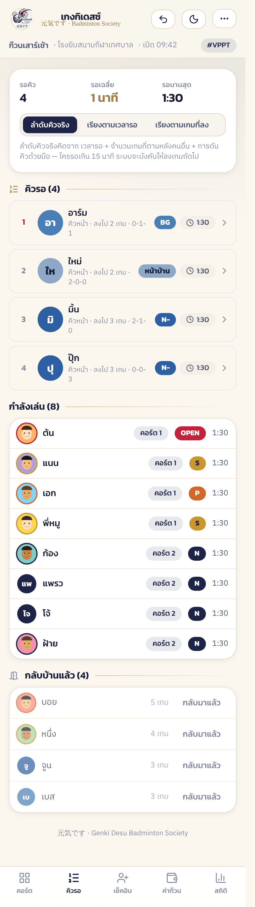</p>

---

### 7. เช็คอิน

หน้านี้ใช้ตอนคนทยอยมาถึงโรงยิม เลือกชื่อจากทะเบียนเพื่อเช็คอินทีละคนหรือหลายคนพร้อมกัน

<p align="center">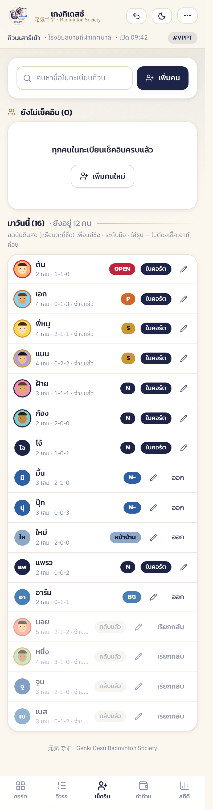</p>

ถ้ามีคนที่ยังไม่เคยอยู่ในทะเบียนมาถึงหน้างาน กด **"เพิ่มคน"** ในหน้านี้ได้เลย
ระบบจะเพิ่มชื่อเข้าทะเบียนและเช็คอินให้พร้อมกันในขั้นตอนเดียว ไม่ต้องสลับไปหน้าทะเบียนก่อน

<p align="center">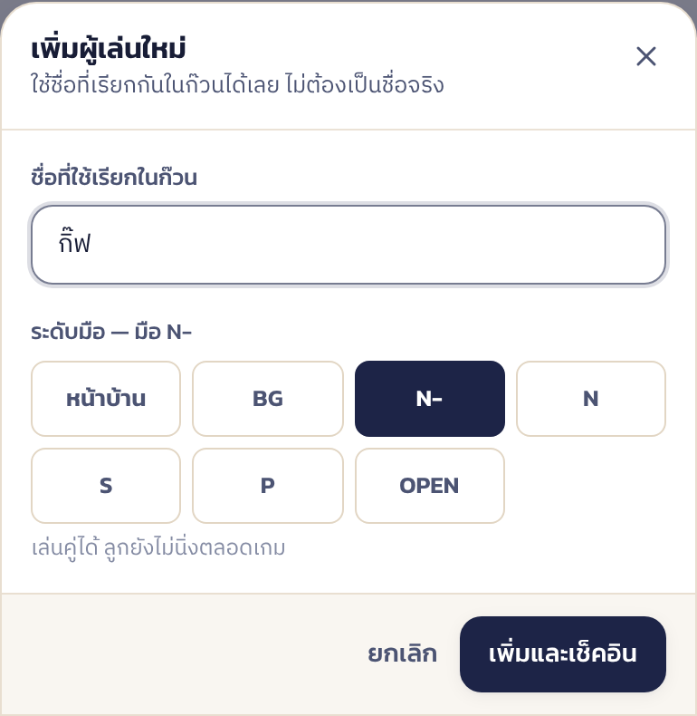</p>

---

### 8. คิดเงิน / เก็บเงิน

หน้าบิลสรุปยอดของทุกคนในก๊วนวันนี้ แยกตามค่าคอร์ตและค่าลูกที่ใช้ไป คนที่เก็บเงินแล้วจะมีเครื่องหมายกำกับ

<p align="center">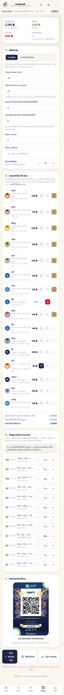</p>

กดชื่อใครก็ได้เพื่อเปิดใบเก็บเงินของคนนั้น มี **QR พร้อมเพย์ผูกยอดเงินให้อัตโนมัติ** และปุ่ม
"รับเงินแล้ว" กดบันทึกตอนเก็บเงินเสร็จ

<p align="center">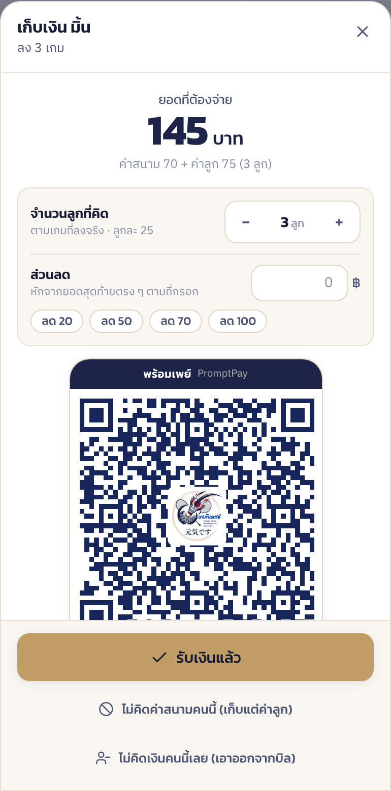</p>

#### ปรับจำนวนลูก / ให้ส่วนลด

ในใบเก็บเงินเดียวกันนี้ เลื่อนลงจะเจอแผงปรับยอด — กดปุ่ม **+ / −** เพื่อปรับจำนวนลูกเฉพาะคนนี้
(เช่น มาสายเล่นน้อยกว่าคนอื่น หรือใช้ลูกเพิ่ม) หรือกดปุ่มลดราคาด่วน / กรอกจำนวนส่วนลดเป็นบาทเองก็ได้

<p align="center">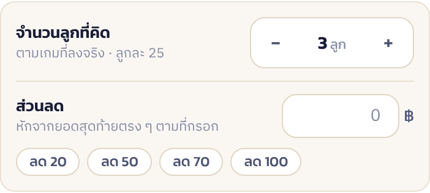</p>

#### ยกเว้นไม่เก็บเงินคนนี้

บางกรณี (เช่นเจ้าของก๊วน/แขกรับเชิญ) ไม่อยากเก็บเงินเลย กดปุ่มเอาออกจากบิลได้
คนนั้นจะไม่มี QR ให้จ่ายและไม่ถูกรวมยอด

<p align="center">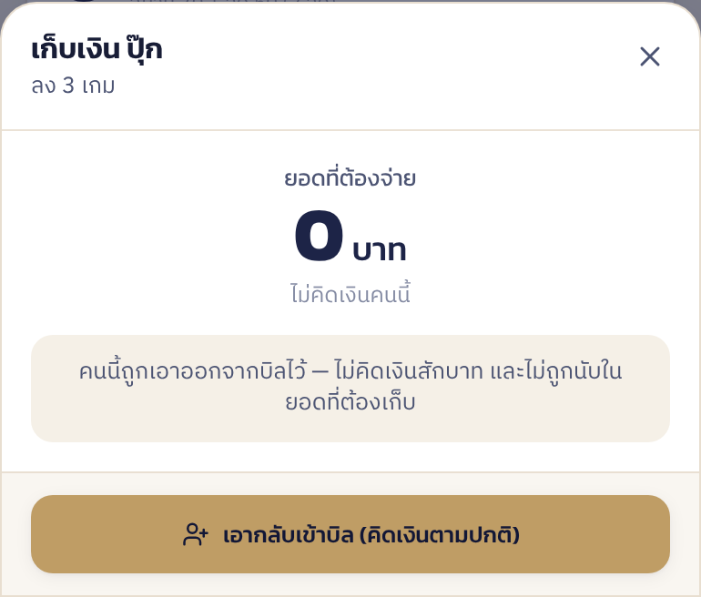</p>

---

### 9. สถิติ

#### ก๊วนวันนี้

เกมที่ลง ชนะ-เสมอ-แพ้ เวลาเล่นรวม เวลารอรวมของแต่ละคน พร้อมรางวัลประจำก๊วน
(ลงเยอะสุด / ใจเย็นสุด / ชนะเยอะสุด)

<p align="center">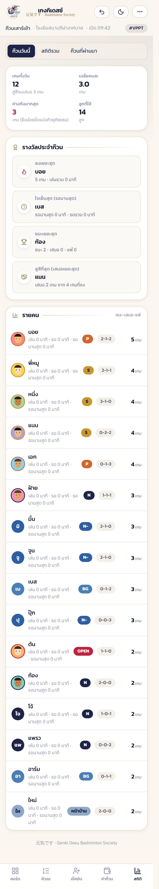</p>

#### สถิติรวมทุกก๊วน

สะสมจากทุกครั้งที่เคยมา ไม่ใช่แค่วันนี้

<p align="center">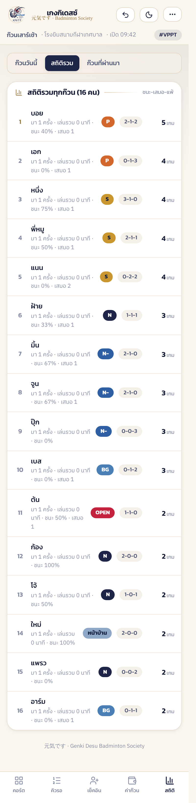</p>

#### ก๊วนที่ผ่านมา

ดูย้อนหลังแต่ละครั้งแยกก๊วน ลบก๊วนที่ไม่อยากเก็บได้จากหน้านี้ (ก๊วนที่ยังเล่นอยู่ลบไม่ได้ ต้องปิดก่อน)

<p align="center">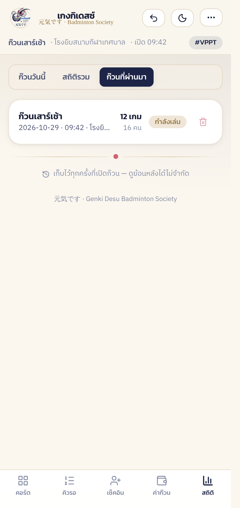</p>

---

### 10. ตั้งค่า และสำรอง/กู้ข้อมูล

หน้าตั้งค่ารวมเรื่องทั่วไปของระบบ เช่น PIN หัวก๊วน และโหมดกลางคืน

<p align="center">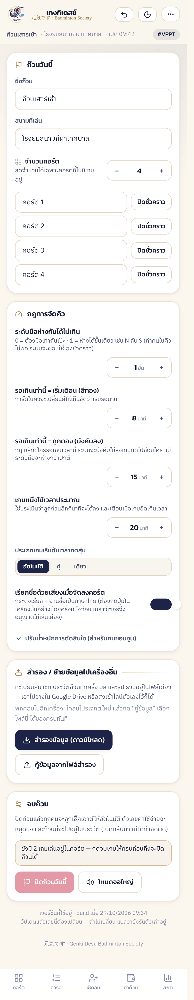</p>

ส่วนสำคัญที่สุดในหน้านี้คือแถบ **"สำรอง / ย้ายข้อมูลไปเครื่องอื่น"** — กด **"สำรองข้อมูล"**
เพื่อดาวน์โหลดไฟล์เดียวที่มีทะเบียน ประวัติก๊วนทุกครั้ง บิล และรูปครบ พกไปเปิดที่เครื่องไหนก็ได้

<p align="center">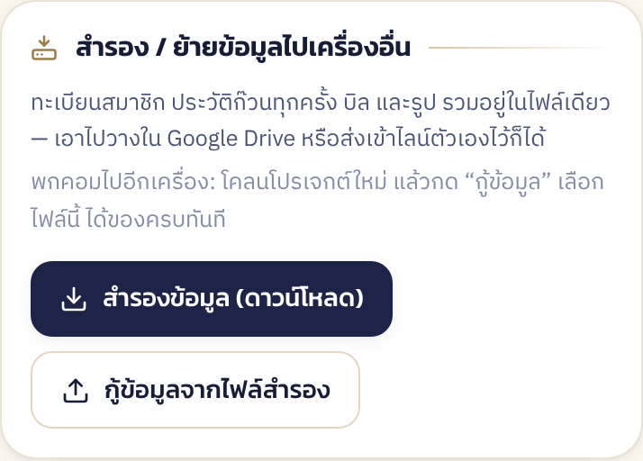</p>

กด **"กู้ข้อมูลจากไฟล์สำรอง"** แล้วเลือกไฟล์ ระบบจะโชว์ให้ดูก่อนว่าในไฟล์มีสมาชิกกี่คน
ก๊วนกี่ครั้ง สำรองไว้เมื่อไร ก่อนกดยืนยันกู้จริง (กู้ทับของเดิมได้อย่างปลอดภัย เพราะระบบจะย้าย
ข้อมูลเก่าไปเก็บสำรองให้ก่อนเสมอ กดผิดไฟล์ก็เอากลับมาได้)

<p align="center">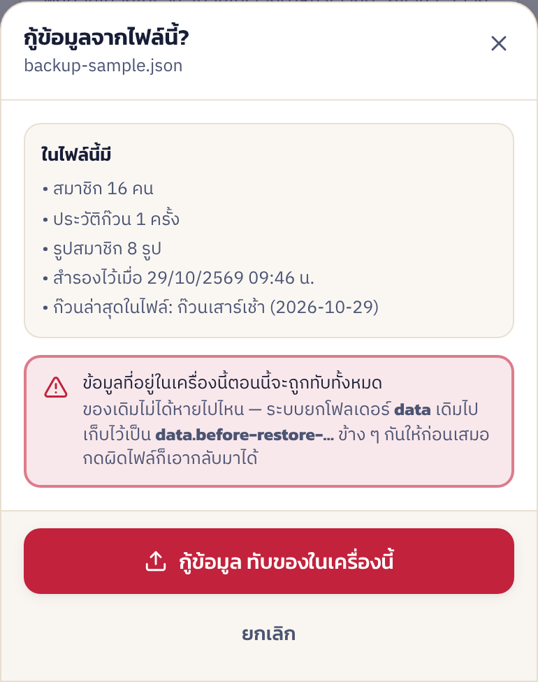</p>

---

### 11. แชร์ให้ลูกก๊วนดูคิวเอง

จากเมนู (⋯) กด **"แชร์ลิงก์ดูคิว"** จะได้ลิงก์สั้น ๆ พร้อม QR ให้ส่งเข้ากลุ่มไลน์
ใครก็เปิดดูได้โดยไม่ต้องล็อกอิน

<p align="center"></p>

ลูกก๊วนที่เปิดลิงก์จะเห็นหน้าเลือกชื่อตัวเองก่อนครั้งแรก

<p align="center">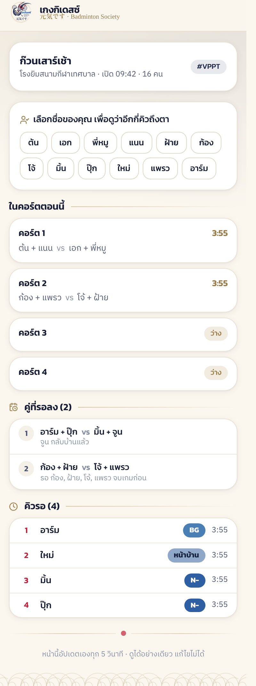</p>

พอเลือกชื่อแล้ว หน้าจะบอกชัดเจนว่า **คิวที่เท่าไร อีกกี่เกม ประมาณกี่นาที** และถ้าถูกจัดไว้ในคู่แล้ว
จะขึ้นว่า "คุณถูกจัดไว้แล้ว" พร้อมชื่อคู่แข่ง

<p align="center">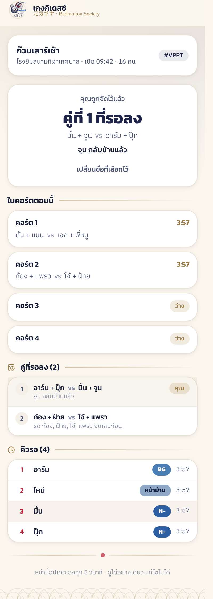</p>

---

### 12. จอใหญ่ (TV)

เข้าหน้า `/tv` จากคอมหรือทีวีที่ต่อไว้ข้างคอร์ต แบ่งสองคอลัมน์: ซ้ายคือคอร์ตที่กำลังเล่นอยู่
(ชื่อตัวใหญ่ นาฬิกาจับเวลา) ขวาคือคู่ถัดไปที่รอลง ลูกก๊วนดูเองได้โดยไม่ต้องถามหัวก๊วน

<p align="center">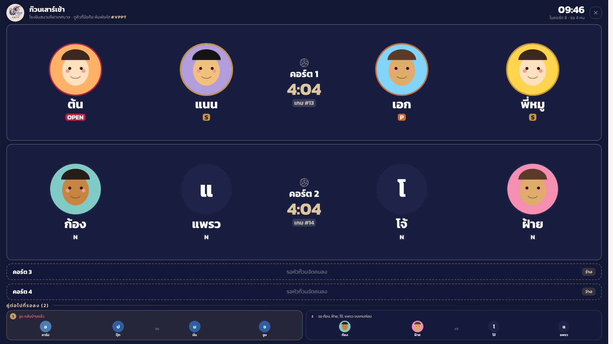</p>

---

### 13. ลบคนออกจากทะเบียน

จากหน้าทะเบียนสมาชิก กดดินสอ (แก้ข้อมูล) ของคนที่ต้องการลบ แล้วกดปุ่ม **"ลบ"** สีแดง
ท้ายฟอร์ม

#### คนที่ยังไม่เคยลงก๊วน — ลบจบในคลิกเดียว

ถ้าชื่อนั้นเพิ่งเพิ่มเข้าทะเบียนและยังไม่เคยลงเล่นเกมไหนเลย ระบบจะถามแค่ครั้งเดียวแล้วลบจริง
เหมาะกับกรณีเพิ่มชื่อซ้ำหรือเพิ่มผิดคน

<p align="center">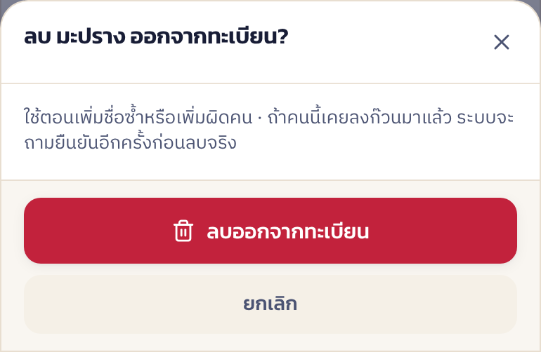</p>

#### คนที่เคยลงก๊วนแล้ว — ต้องยืนยันสองชั้น

ถ้าคนนั้นเคยลงเล่นมาก่อน ระบบจะถามครั้งแรกเหมือนเดิม

<p align="center">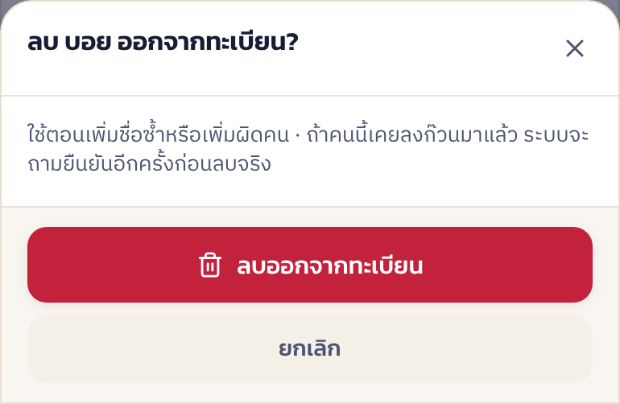</p>

แล้วจึงเปิดหน้ายืนยันอีกชั้น **บอกชัดเจนว่าเคยลงก๊วนไปแล้วกี่ครั้งกี่เกม** พร้อมอธิบายผลที่จะเกิดขึ้น
(ชื่อจะหายจากทะเบียนและหน้าจัดคน แต่บิล/สถิติของก๊วนเก่าจะไม่ถูกแตะต้อง ยอดเงินเดิมไม่ขยับ)
ถ้าแค่อยากเอาชื่อออกจากหน้าเช็คอินแต่ไม่อยากลบประวัติ มีปุ่ม **"เก็บเข้ากรุแทน"** ให้เลือกแทนได้

<p align="center">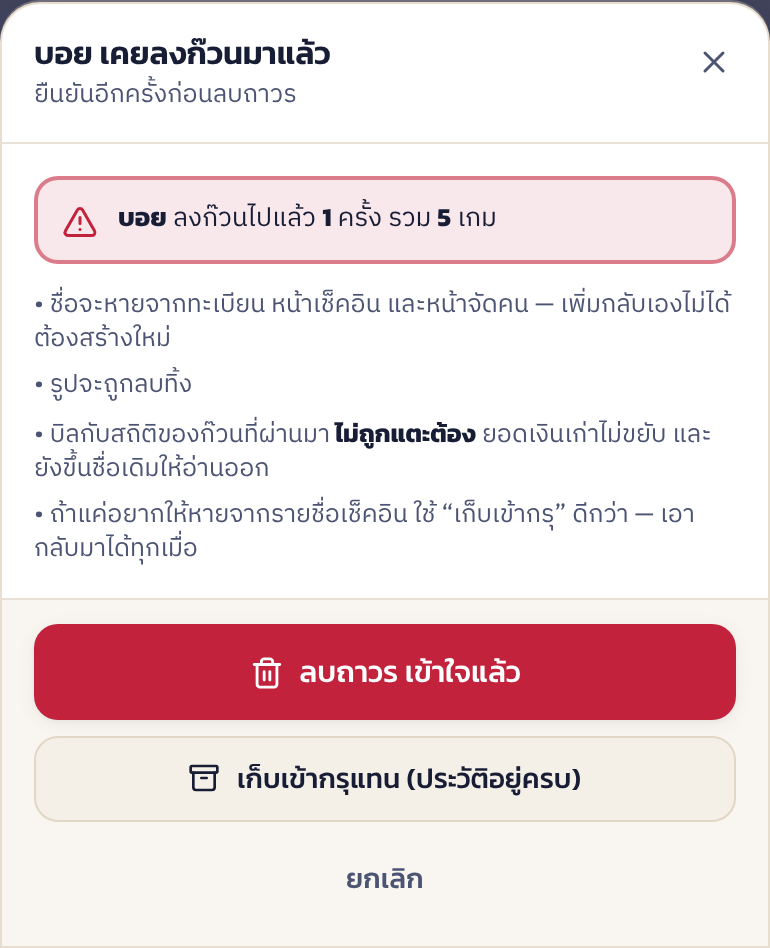</p>

> คนที่กำลังเล่นอยู่ในคอร์ตตอนนั้น ลบไม่ได้จนกว่าจะจบเกมก่อน

---

## ถ้าเจอปัญหา

**หน้าไม่ขึ้น / ปุ่มไม่ทำงาน หลังอัปเดตโค้ด** — เกือบทุกครั้งคือเบราว์เซอร์ยังใช้ไฟล์เวอร์ชันเก่าค้างอยู่
(แอปติดตั้งเป็น PWA ได้ จึงมีการแคชไฟล์ไว้):

```bash
git pull
npm ci
npm run serve        # build แล้วรันในคำสั่งเดียว — กันลืม build
```

แล้วในเบราว์เซอร์กด refresh แบบล้างแคช (Ctrl/Cmd + Shift + R) หรือถ้าหน้าขึ้นกล่องแดง
ให้กดปุ่ม **"ล้างแคชแล้วโหลดใหม่"** ในกล่องนั้น

**หน้าขึ้นกล่องแดงบอก error** — ข้อมูลก๊วนไม่ได้หาย อยู่ในโฟลเดอร์ `data/` ครบ
ถ่ายข้อความในกล่องไว้แล้วแจ้งได้เลย

**เปิดแท็บอื่นแล้วบอกว่า "ยังไม่ได้เปิดก๊วนวันนี้"** — คือยังไม่ได้กดเปิดก๊วน
หน้าคิว/เช็คอิน/ค่าก๊วน จะใช้ได้หลังเปิดก๊วนแล้วเท่านั้น
(แต่ **ทะเบียนสมาชิก** กับ **สถิติ** เข้าได้ตลอด ไม่ต้องเปิดก๊วน — กดปุ่มในหน้านั้นได้เลย)

**สองเครื่องเห็นไม่ตรงกัน** — ทุกเครื่องดึงสถานะใหม่ทุก 3 วินาที ถ้าเครื่องหนึ่งเปิดก๊วนใหม่
อีกเครื่องจะตามมาเองภายในไม่กี่วินาที (ไม่ต้องรีเฟรช)

---

## โครงสร้างโค้ด

```
genki-badminton/
├── shared/
│   ├── club.ts            ข้อมูลประจำก๊วน (สนาม ตาราง ค่าสนาม ค่าลูก เลขพร้อมเพย์) — แก้ที่เดียว
│   ├── promptpay.ts       สร้าง payload ของ QR พร้อมเพย์ที่ฝังยอดเงิน + CRC
│   ├── promptpay.test.ts  13 เทสต์: CRC ตรงกับ QR ใบจริง, ฝังยอด, แปลงเบอร์/เลขบัตร
│   └── types.ts           โดเมนทั้งหมด + สูตร priority/waitTier (ใช้ร่วมกันสองฝั่ง)
├── api/
│   ├── matching.ts        เครื่องจัดคิว — ฟังก์ชันล้วน ไม่แตะ I/O
│   ├── matching.test.ts   22 เทสต์: ความเป็นธรรม, มือใกล้เคียง, ไม่ซ้ำคู่, ประเมินคิว
│   ├── bill.test.ts       12 เทสต์: 2 วิธีหารเงิน, ค่าลูกตามเกม, ปัดเศษ
│   ├── store.ts           อ่าน/เขียน JSON (atomic) + undo + คิดบิล + ประกอบข้อมูลให้หน้าเว็บ
│   └── boot.ts            Hono REST API + เสิร์ฟไฟล์หน้าเว็บตอน production
├── src/
│   ├── lib/               api client, สถานะรวมของแอป, เราเตอร์จิ๋ว, เสียงเรียก
│   ├── components/        Logo/Modal/Stepper, การ์ดคอร์ต, แถวคิว, หน้าต่างจัดเกม
│   └── pages/             คุมก๊วน · คิว · เช็คอิน · ค่าก๊วน · สถิติ · ตั้งค่า · จอใหญ่ · ดูคิว
└── public/                โลโก้ + ไอคอน PWA + QR พร้อมเพย์ + service worker
```

**ทำไมเก็บข้อมูลเป็น JSON ไม่ใช่ฐานข้อมูล** — ก๊วนแบดคือข้อมูลเล็ก (คนไม่กี่สิบ เกมไม่กี่ร้อยต่อครั้ง)
แต่ต้องไม่ล่มตอนอยู่ในโรงยิม: ไม่มี native module ให้คอมไพล์ ไม่มี migration ให้พลาด
ย้ายเครื่องใช้ปุ่ม “สำรองข้อมูล / กู้ข้อมูล” ในหน้าตั้งค่าได้เลย (หรือจะก็อปโฟลเดอร์ `data/` เองก็ได้)
และเปิดดูย้อนหลังด้วย text editor ได้
เขียนไฟล์แบบ write-temp + rename กันไฟล์พังตอนไฟดับ

### เก็บข้อมูลไว้ใน git (ย้ายเครื่องด้วย git clone)

อยากให้ `git clone` แล้วเปิดใช้ได้เลยโดยมีข้อมูลครบ — ทำได้ แต่ต้อง**ทำ repo เป็น private ก่อน**

> **ทำไมต้อง private**
> ในโฟลเดอร์ `data/` มี **รูปหน้าและชื่อลูกก๊วน** กับประวัติว่าใครจ่ายเท่าไร
> ซึ่งเป็นข้อมูลของคนอื่นที่เขาไม่ได้ยินยอมให้เอาขึ้นเน็ต และ git ลบย้อนหลังไม่ได้จริง —
> ต่อให้ลบไฟล์ทีหลัง ของเก่ายังอยู่ใน history และใน clone/fork ที่คนอื่นดึงไปแล้ว

**ครั้งแรก — ทำให้เป็น private**

1. เปิด `https://github.com/<ชื่อคุณ>/genki-badminton/settings`
2. เลื่อนลงล่างสุด **Danger Zone** → **Change repository visibility** → **Make private**
3. ถ้าเครื่องนี้ยังไม่เคยใช้ git มาก่อน ตั้งชื่อกับอีเมลครั้งเดียว:

   ```bash
   git config --global user.name "ชื่อคุณ"
   git config --global user.email "อีเมลที่ใช้กับ GitHub"
   ```

4. สั่ง `npm run save-data`

> ข้อ 3 ลืมได้ไม่เป็นไร — สคริปต์เช็คให้ตั้งแต่ก่อนเริ่ม แล้วบอกคำสั่งที่ต้องรันให้เลย

**ใช้งานประจำ**

| ทำอะไร | คำสั่ง |
|---|---|
| จบก๊วนแล้วเก็บข้อมูลขึ้น GitHub | `npm run save-data` |
| ไปถึงอีกเครื่อง ดึงข้อมูลล่าสุดลงมา | `git pull` แล้ว `npm start` |
| เครื่องใหม่ตั้งแต่ต้น | `git clone …` → `npm ci` → `npm start` (เช็ค `node -v` ให้ได้ 20.19+ ก่อน) |

`npm run save-data` จะ:

- **เช็คก่อนทุกครั้งว่า repo เป็น private จริง** ถ้ายัง public อยู่จะไม่ push ให้
  แล้วบอกวิธีไปเปลี่ยน (เช็คกับ GitHub ไม่ได้ก็จะถามยืนยันแทน)
- ดึงของใหม่จากเครื่องอื่นลงมาก่อนเสมอ กัน conflict
- commit เฉพาะไฟล์ข้อมูลจริง — ไม่เอาไฟล์สำรอง `.bak` · `.broken-*` · `.deleted-*`
  และโฟลเดอร์ `data.before-restore-*` ขึ้นไปให้รก

> **ใช้ทีละเครื่อง** — วิธีนี้ไม่ใช่ sync สองทาง ถ้าสองเครื่องแก้ข้อมูลพร้อมกันจะชนกัน
> และไฟล์ JSON รวมอัตโนมัติไม่ได้ · กฎง่าย ๆ คือ **จบก๊วน → `save-data` ทุกครั้ง**
> และ **เครื่องถัดไป → `git pull` ก่อนเริ่มเสมอ**
> (ถ้าชนกันจริง สคริปต์จะบอกวิธีแก้ทีละขั้นให้)

### API ย่อ

| Endpoint | ทำอะไร |
|---|---|
| `GET /api/bootstrap` | สถานะทั้งหมดของหน้าเว็บในครั้งเดียว |
| `GET /api/view/:id` · `GET /api/q/:code` | ดึงสถานะก๊วน (แบบหัวก๊วน / แบบลูกก๊วน) |
| `POST /api/session/:id/suggest` | ขอข้อเสนอเกม (คืนทีม + เหตุผล + ชุดสำรอง) |
| `POST /api/session/:id/start` · `/finish` · `/cancel` · `/swap` | คุมเกมในคอร์ต |
| `POST /api/session/:id/checkin` · `/checkout` · `/rest` · `/boost` · `/paid` | คุมคน |
| `GET /api/session/:id/summary` · `/matches.csv` | สรุปส่งไลน์ / ส่งออกข้อมูล |
| `GET /api/backup` · `POST /api/restore` | สำรอง/กู้ข้อมูลทั้งก้อนเป็นไฟล์เดียว (ย้ายเครื่อง) |

ทุก endpoint ที่แก้ข้อมูลตอบสถานะชุดใหม่กลับมาเลย — หน้าเว็บอัปเดตในรอบเดียว (สำคัญตอนเน็ตโรงยิมอืด)

---

## ที่อยากทำต่อ (เรียงตามความคุ้มค่า)

**1. ลงชื่อล่วงหน้า + ไลน์**
ประกาศก๊วน (วัน-เวลา-สนาม-ค่าหัว) แล้วส่งลิงก์ให้กดลงชื่อ มีจำนวนจำกัด + คิวสำรอง
หัวก๊วนเห็นก่อนวันจริงว่าคนพอไหม ต่อยอดเป็น LINE LIFF / LINE Notify ได้เลยเพราะก๊วนอยู่บนไลน์

**2. แจ้งเตือนเข้ามือถือเมื่อใกล้ถึงคิว**
Web Push: "อีก 1 เกมถึงคิวคุณ" — ไปเข้าห้องน้ำ/กินข้าวได้ไม่ต้องเฝ้าจอ
(โครงสร้าง service worker มีอยู่แล้ว เพิ่มเฉพาะส่วน subscribe + ส่ง)

**3. ปรับระดับมืออัตโนมัติ**
ใช้ผลแพ้-ชนะขยับระดับมือแบบ Elo อ่อน ๆ แล้วเสนอหัวก๊วนว่า "คนนี้น่าจะขึ้น S แล้ว"
— แก้ปัญหาที่ระดับมือกรอกไว้ตอนแรกแล้วไม่มีใครอัปเดต

**4. โหมดแข่งในก๊วน**
King of the court (ชนะอยู่ต่อ), Americano/Mexicano (หมุนคู่ให้ครบทุกคน), สายแพ้คัดออก

**5. QR เช็คอินหน้างาน**
ติด QR ที่โต๊ะ ลูกก๊วนสแกนเช็คอินเอง หัวก๊วนไม่ต้องกดให้ทุกคน

**6. สถิติเชิงลึก**
คู่ที่เข้ากันดี (win rate แยกตามคู่), กราฟเวลารอรายคนทั้งวัน, สรุปรายเดือนว่าใครมาบ่อย

**7. สต็อกลูกแบด + ค่าสมาชิกรายเดือน**
ลูกคงเหลือในก๊วน, ใครยืมลูกไป, เครดิตสมาชิกรายเดือนหักอัตโนมัติ

---

<div align="center">
  <sub>元気です · Genki Desu Badminton Society</sub>
</div>
